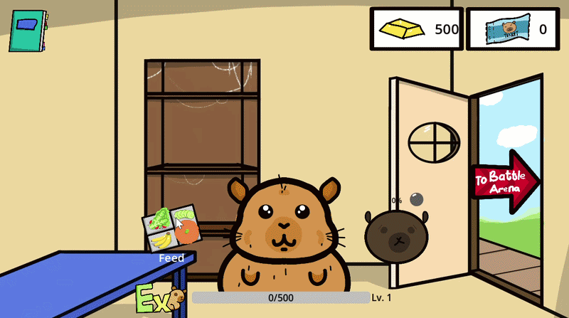
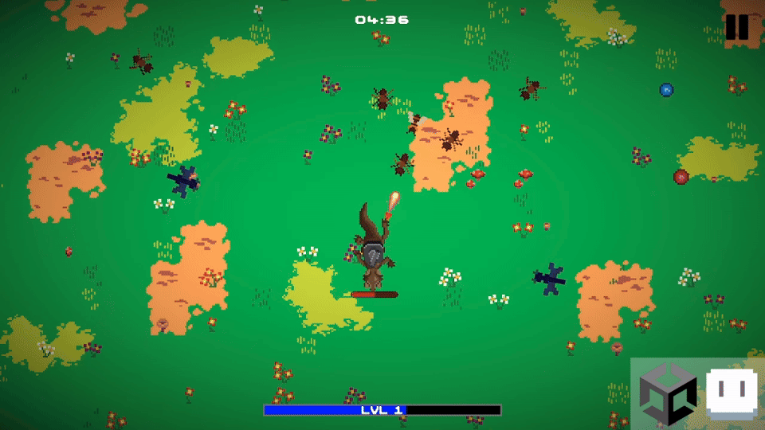
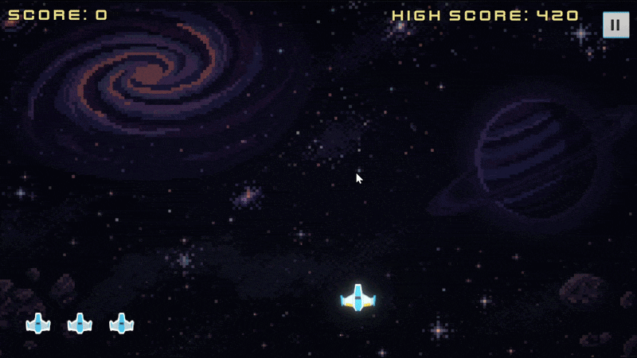
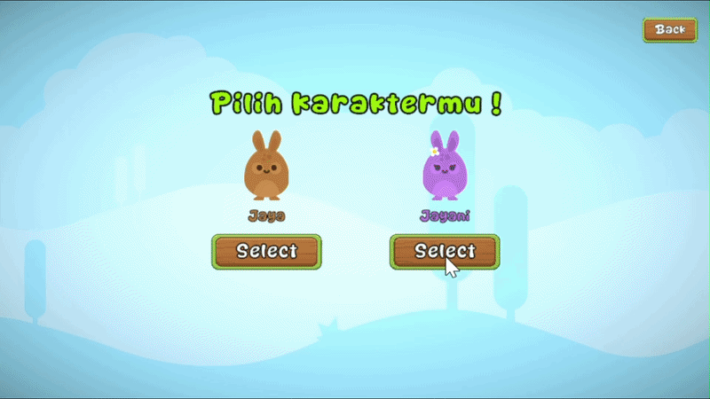

# Hi, I'm Natnat 👋

5th semester Computer Science student at BINUS University who spends way too much time making (and playing) games.
I work with Unity and Godot for 2D games, and currently diving into 3D modeling for game assets.
Outside of coding, I'm into UI/UX and occasionally do some design work.

## 🎮 Game Projects

<table>
  <tr>
    <th>Crappybara</th>
    <th>Gecko Of All Time</th>
  </tr>
  <tr>
    <td align="center" width="50%">
      
    </td>
    <td align="center" width="50%">
      
    </td>
  </tr>
  <tr>
    <td align="center">
      A 2D virtual pet and idle collector built with Godot. Raise a capybara, battle for gold and XP, and unlock rare skins through a gacha system.
    </td>
    <td align="center">
      A 2D survivor-style shooter built with Unity. Control a gecko with a mouse-aimed turret, survive endless monster waves, and level up with upgrades.
    </td>
  </tr>
  <tr>
    <td align="center">
      
      
    </td>
    <td align="center">
      
      
    </td>
  </tr>
</table>

<table>
  <tr>
    <th>The Coulus</th>
    <th>Lompat Jaya</th>
  </tr>
  <tr>
    <td align="center" width="50%">
      
    </td>
    <td align="center" width="50%">
      
    </td>
  </tr>
  <tr>
    <td align="center">
      A 2D pixel-art arcade shooter built with Unity. Blast through waves of enemies, collect hearts to survive, and take down a laser-firing boss.
    </td>
    <td align="center">
      A 2D arcade platformer built with Unity, inspired by Pou. Pick your character and jump as high as you can before the platforms run out.
    </td>
  </tr>
  <tr>
    <td align="center">
      
      
    </td>
    <td align="center">
      
      
    </td>
  </tr>
</table>

## 📁 Other Projects
- Catch The Phish (in progress)
- Mukbang Mania (in progress)

## 🛠️ Tools & Skills

