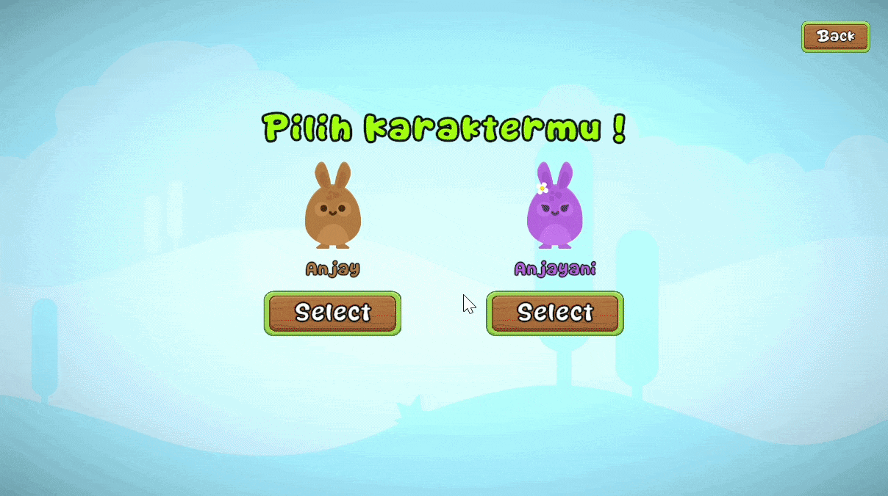
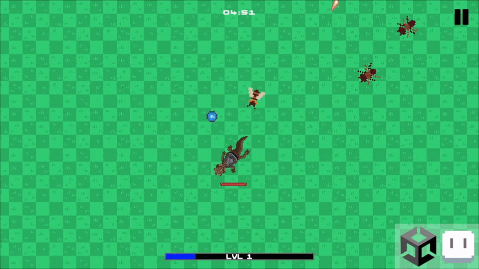

# Hi, I'm Natnat 👋

5th semester CS student at BINUS University who spends way too much time making (and playing) games.
I work with Unity and Godot for 2D games, and currently diving into 3D modeling for game assets.
Outside of coding, I'm into UI/UX and occasionally do some design work.

## 🎮 Game Projects

<table>
  <tr>
    <th>The Coulus</th>
    <th>Lompat Anjay</th>
    <th>Crappybara</th>
    <th>Gecko Of All Time</th>
  </tr>

  <tr>
    <td align="center">
      
    </td>
    <td align="center">
      
    </td>
    <td align="center">
      
    </td>
    <td align="center">
      
    </td>
  </tr>

  <tr>
    <td align="center">
      A 2D endless shooter built with Unity. Survive waves of enemies, manage your resources, and take down bosses.
    </td>
    <td align="center">
      A Doodle Jump-style platformer built with Unity. Pick your character and jump as high as you can before the platforms run out.
    </td>
    <td align="center">
      A 2D virtual pet and idle collector built in Godot. Raise a capybara, grind battles for gold and XP, and unlock rare skins through a gacha system.
    </td>
    <td align="center">
      A 2D pixel-art auto-battler dungeon crawler built in Unity, where you clear procedurally regenerated floors and gamble for card packs to build a team of butterflies with synergistic abilities. Gecko Of All Time is a roguelike shoot ‘em up video game. Player controls a geck while battling continuous waves of monsters, aiming to survive the battle for as long as possible.
    </td>
  </tr>

  <tr>
    <td align="center">
      
      
    </td>
    <td align="center">
      
      
    </td>
    <td align="center">
      
      
    </td>
    <td align="center">
      
      
    </td>
  </tr>
</table>

## 🛠️ Tools & Skills

